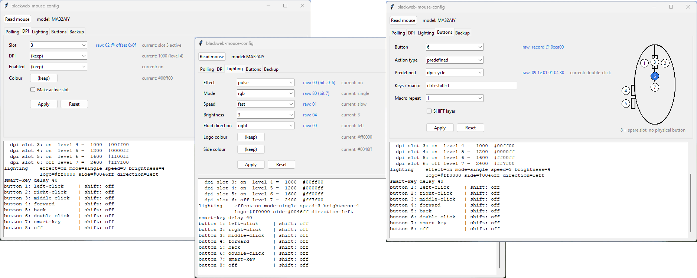

# blackweb-mouse-config
Unofficial cross-platform configurator for Blackweb gaming mice. It works as an alternative to the Windows-only "Blackweb Gaming AP" app on Windows, macOS and Linux. It has a command-line tool (`src/bwmc.py`) and a small GUI (`src/bwmc_gui.py`).

Reading and writing the configuration has been confirmed on a real MA32AIY model.

> [!WARNING]
> **Disclaimer.** This project was created using AI tools. It was a personal project to test the [Reverse Engineer Anything (REA)](https://github.com/morluto/rea) skill capabilities. **It is not intended to replace the official application.** See the [AI usage disclosure](#ai-usage-disclosure) section below.

> [!CAUTION]
> **Use at your own risk.** Although the script always backs up the device memory before writing, I can't guarantee that it is safe to use. I don't know if it's possible to brick the mouse if the wrong values are written.

> [!IMPORTANT]
> **This project is not affiliated with or endorsed by Blackweb or Walmart.** The protocol was reverse-engineered from the vendor app (see [PROTOCOL.md](PROTOCOL.md)) using [Reverse Engineer Anything (REA)](https://github.com/morluto/rea).

## Screenshots



## Supported mice
| Model | USB ID |
|---|---|
| MA32AIY | 3938:1170 |
| AYC | 3938:1093 |
| AYU | 3938:1146 |

What you can set: polling rate, 6 DPI slots (level, colour, on/off), lighting (effect, mode, speed, brightness, logo and side colour, fluid direction), and button assignments. Buttons can be predefined actions, key combos or macros, on both the normal and the SHIFT layer.

## Install
Requires Python 3.9 or newer.
```
python -m venv .venv
.venv/bin/pip install -r requirements.txt        # Windows: .venv\Scripts\pip install -r requirements.txt
```
On Linux:
- Install Tk for the GUI, for example `sudo apt install python3-tk`.
- Allow access to the mouse without root. Create `/etc/udev/rules.d/70-blackweb.rules` with this line, then replug the mouse:
  ```
  KERNEL=="hidraw*", ATTRS{idVendor}=="3938", MODE="0660", TAG+="uaccess"
  ```

Activate the venv (`source .venv/bin/activate`, on Windows `.venv\Scripts\activate`), then run everything from inside `src/`:
```
cd src
```

> [!TIP]
> Close the vendor app before using this tool, so both don't talk to the mouse at once.

## GUI
```
python bwmc_gui.py
```
Each input shows the raw bytes it will write and the mouse's current value. The bottom pane logs every command and its output. The Backup tab lists saved backups; double-click one to restore it.

## Command line
```
python bwmc.py show
python bwmc.py polling 500
python bwmc.py dpi 2 --dpi 1600 --color ff8800 --enable --activate   # --dpi must be one of the levels 'show' prints
python bwmc.py dpi 3 --level 9                                         # or pick a raw level 1-9
python bwmc.py light --effect fluid --mode rgb --speed 2 --brightness 3 --direction left
python bwmc.py button 6 dpi-cycle                                      # list actions: python bwmc.py actions
python bwmc.py button 4 keys:ctrl+shift+t
python bwmc.py button 5 macro:"+lmb 20 -lmb 20 +lmb 20 -lmb" --repeat hold
python bwmc.py backup my.bin
python bwmc.py restore my.bin
```
Macro steps: `+key` presses, `-key` releases, a number waits that many milliseconds, and `wheel+1` / `wheel-1` scroll. Keys are letters, digits, `f1`–`f12`, names like `enter` or `space`, `ctrl`/`shift`/`alt`/`win`, mouse buttons `lmb`/`rmb`/`mmb`/`back`/`fwd`, or a raw HID usage like `0xe3`.

## Backups
Before every write, the mouse's current configuration is saved to `backups/bwmc-<model>-YYYYMMDDHHMMSS.bin`, next to the scripts (`src/backups/`). Load any of these with `restore` or from the GUI's Backup tab.

## Tests
```
python test_bwmc.py
```
These run offline, against a fake device. If you have the vendor app installed, copy its `Blackweb Gaming AP` folder into `src/`, next to `test_bwmc.py`. The test then also checks checksums, the predefined actions and macro encoding against the vendor's own files.

## AI usage disclosure
I want to provide transparency and honesty about the use of AI in this project.

This project has been developed with AI tools. AI was used to generate code **without manual intervention or manual deep review** (in short, it was _vibecoded_).

The project is a personal experiment to test the capabilities of AI in reverse engineering and software development.

That's why I do not recommend using this project with the expectation of a fully reliable and safe experience. The code may contain errors, bugs, or vulnerabilities that could lead to unexpected behavior or **even damage to your device**.

## Contributing
Fork the repo, branch from `develop` and open a PR against `develop` of this repository. Use Conventional Commits with descriptive messages. See [CONTRIBUTING.md](CONTRIBUTING.md).

## License
[MIT](LICENSE)
